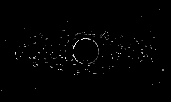
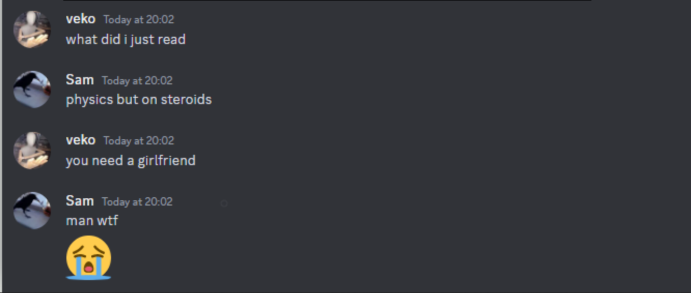

# > hi, i'm [sam](https://www.svsam.com)

i'm currently a student studying physics (astrophysics) and a hobbyist developer! - [svsam.com](https://svsam.com)

i like to program about things i like

---

Currently in development - 
1. Refractor telescope (Blender)
2. H0 parameters across cosmological probes
 

---

<table>
<tr>
<th valign="top" align="left">
  
  
  
</th>

<td valign="top" align="left">

## Look on my works, ye Mighty, and despair

- [**svsam/EvoXRB**](https://github.com/svsam/EvoXRB): Synthetic / NICER-inspired case study on genetic algorithms, and spinning black holes.
- [**svsam/Exoplanet orbital-temperature profiles**](https://github.com/svsam/Exoplanet-orbital-temperatures-and-modelling-eccentricity-using-training-data): Exoplanet comparison and modelling study
- [**svsam/Daybreak-class-expansion**](https://github.com/svsam/Daybreak-class-expansion---Terraria-mod): Terraria weapon class related to the daybreak weapon.
- [**svsam/h0-across-cosmological-probes**](https://github.com/svsam/h0-across-cosmological-probes): On the Hubble constant.
</td>

  
  
</th>
</tr>
</table>
